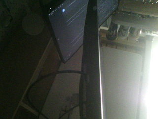
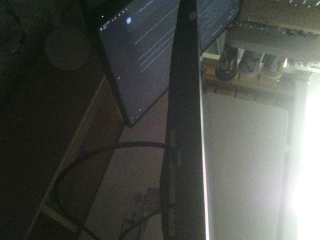

# 视觉固件上板记录（DART Control H7）

- 日期：2026-11-11
- 目标板：DART Control H7（STM32H750，USB CDC 设备 `VID 0483 / PID 5740`）
- 芯片 UID：`002B00303333510D36353234`
- 主机：Windows（VS2019 / OpenCV 4.10 开发环境），串口 `COM14`，115200 8N1
- 依据教程：`dart_control_H7/dart_control_H7/USB_BOOT_GUIDE.md`（H750 USB 命令升级）

## 1. 固件来源与版本

| 项 | 值 |
| --- | --- |
| 固件包 | `Vesna-Eye/dart_control_H7.zip`（用户提供） |
| 仓库 | `dart_control_H7/dart_control_H7`（git HEAD `d13d6f6 新增.GitHub`，工作区含本地修改） |
| 预编译 ELF | `build/Debug/GMStdRobotLib.elf`，3,042,408 B，构建时间 **2026-11-06 17:56:20**（晚于最后源码修改 17:55:50） |
| 提取的 Flash 镜像 | `build/Debug/GMStdRobotLib_dfu.bin`，**130,400 B**（`0x08000000`–`0x0801FD60`） |
| 向量表检查 | 初始 SP=`0x20020000`，Reset=`0x08014499`（Thumb） |
| Flash 占用 | 130,400 / 131,072 B（**99.5 %**） |

该固件包含相机（OV5640）与视频录制任务：`Task/src/tsk_camera.cpp`、`Task/src/tsk_video_test.cpp`
（命令 `VIDEO RECORD`、`SD FILES`、`SD GET`、`SD DELETE`），当前测试配置为
`H750_STANDALONE_TEST=1`、`H750_STANDALONE_CAMERA_TEST=1`（独立 USB 相机测试模式）。

## 2. 烧录流程（实际执行）

教程要求 `cmake --build --preset Debug` + `flash_usb.ps1`（STM32CubeProgrammer）。
本机缺少 ARM 工具链与 STM32CubeProgrammer，且 Windows 未安装 STM32 DFU 驱动，
因此改用 **预编译 ELF + ROM DFU + WSL2 dfu-util** 完成，步骤如下：

1. **确认应用在线**：打开 `COM14`，发送 `PING` → 回复 `PONG`；
   `PARAMS` 显示 `MCU_UID=002B00303333510D36353234`、`USB_BOOT=ROM_DFU_V1`。
2. **进入 ROM DFU**：串口发送 `BOOT\n`，固件回复 `OK BOOT DFU` 后复位并跳转 STM32H750
   ROM DFU（USB 重新枚举为 `0483:df11`，alt=0 `@Internal Flash /0x08000000/16*128Kg`）。
3. **备份当前固件**：`dfu-util -a 0 -s 0x08000000:131072 -U backup_before_flash_<UID>.bin`
   → 131,072 B 完整备份（保存在 `board/dart_control_H7/`，已被 gitignore）。
4. **写入新固件**：

   ```bash
   dfu-util -a 0 -s 0x08000000:leave -D GMStdRobotLib_dfu.bin
   ```

   日志关键行：`Download done.` / `File downloaded successfully` / `Submitting leave request...`
   （完整日志见 [`docs/board_flash/flash_log.txt`](board_flash/flash_log.txt)）。
5. **重启验证**：设备重新枚举为 CDC `COM14`，`PING` → `PONG`。

### 2.1 为什么用 WSL + usbipd

Windows 侧 `dfu-util` 需要先给 `0483:df11` 安装 WinUSB/libusb 驱动（Zadig / STM32CubeProgrammer
驱动），而本机没有现成驱动且驱动安装需要管理员交互。替代方案：

- 安装 `usbipd-win 5.3.0`（winget：`dorssel.usbipd-win`）；
- `usbipd bind --busid 5-9`（管理员），`usbipd attach --wsl --busid 5-9`；
- 在 WSL2 Ubuntu 内使用 dfu-util 0.11 静态版（`board/tools/dfu-util-0.11-binaries/linux-amd64/dfu-util-static`）
  直接访问 USB 设备，完全绕开 Windows DFU 驱动。

复现命令（在 WSL 中，root）：

```bash
/tmp/dfu-util -l
/tmp/dfu-util -a 0 -s 0x08000000:leave -D /mnt/f/github_hub/Vesna-Eye/board/dart_control_H7/dart_control_H7/build/Debug/GMStdRobotLib_dfu.bin
```

## 3. 上板验证结果

| 检查 | 结果 |
| --- | --- |
| `PING` | `PONG` ✅ |
| `PARAMS` | UID 不变 `002B00303333510D36353234`，`USB_BOOT=ROM_DFU_V1` ✅ |
| `STATUS DETAIL` | `MODE=USB_CAMERA_STANDALONE`、`CAMERA=READY`、`CAM_ID=0x5640`、`SD=MOUNTED`、`I2C_ERR=0` ✅ |
| 新固件命令 `SD FILES` | `FILES END`（旧固件无此命令）✅ |
| `VIDEO RECORD` | `VIDEO DONE FILE=REC000.AVI FRAMES=84 ELAPSED_MS=15021 LATE=83`（命令链路 OK，**但图像内容为常量，见 §3.1**）⚠️ |
| SD 文件 | `FILE REC000.AVI 12904660 32`（约 12.3 MiB，内容待确认）⚠️ |

### 3.1 上板后发现的问题：相机图像为常量（已修复，见 §3.2）

烧录后进一步用 `CAMERA SNAP` 抓取单帧（协议：`FRAME BEGIN RGB565 320 240 153600` +
153600 B 原始 RGB565 + `FRAME END`），结果：

```text
frame 0 sha 85fc7399227dac61 first16 [32, 0, 32, 0, ...]
frame 1 sha 85fc7399227dac61 first16 [32, 0, 32, 0, ...]
frame 2 sha 85fc7399227dac61 first16 [32, 0, 32, 0, ...]
```

- 3 帧**逐字节完全相同**，153600 B 中只有 `0x20` 和 `0x00` 两种字节（每像素恒为
  RGB565 `0x0020`），不是真实图像（真实传感器必然有噪声/场景差异）；
- `VIDEO RECORD` 能完成并写出 84 帧 AVI，但内容同样是常量；
- `CAMERA TEST` 返回 `CAMERA PASS ID=0x5640`，但它只校验 I2C 传感器 ID/状态，**不校验图像数据**；
- `CAMERA DIAG` 显示 I2C/GPIO 正常（SCL=1 SDA=1 RESETB=1 PWDN=0），`CAMERA PROBE` 读到 ID `0x5640`；
- 代码里 `defaultFrameBuffer` 位于 `.dma_buffer (NOLOAD)` 段（启动不初始化），
  快照路径只根据 DCMI 帧事件判定“帧就绪”，不校验 DMA 是否真的写入了有效像素；
  因此常量帧可能是 **DCMI 数据未真正写入**（数据线/FPC/PCLK/MCLK/电源）或
  **传感器未进入输出模式**，而非简单的“画面全黑”。

结论：**固件烧录与命令链路可用，但视觉图像数据通路尚未验证通过**，需要继续排查
（硬件信号 + 固件诊断）后才能说“视觉软件可用”。

### 3.2 固件修复与重烧验证（已通过）

针对 §3.1 的常量帧问题，修改了固件相机任务 `Task/src/tsk_camera.cpp`：

1. **抓帧之间不再给传感器掉电**：`ReleaseCaptureResources()` 不再调用 `Ov5640::Stop()`
   （该函数写 `0x3008=0x42` 进入软件掉电，而 `Ov5640::Start()` 只写 `0x02`，不会恢复完整
   寄存器配置，导致下一次抓帧没有像素数据）；只停止 DCMI。
2. **传感器只启动一次**：`StartCapture()` 用 `sensorStreaming` 标记，首次启动后延时 20 ms
   让 PLL/输出稳定，后续抓帧只重启 DCMI。
3. **抓帧前清零 DMA 缓冲区**（`memset` + cache clean），避免把 NOLOAD 段残留内容当成图像。
4. **帧有效性校验 + 重试**：按前 8 KiB 的不同字节值数量判断是否真实图像（常量帧只有 2 种值），
   无效则自动重试最多 2 次，再失败才报错。
5. 新增 `invalidFrames`/`captureRetryCount` 内部计数，便于后续诊断。

编译与烧录：

- 工具链：Arm GNU Toolchain 14.2.Rel1 + Ninja 1.13.2 + CMake；
- **Debug 构建在 GCC 14 下超出 128 KiB Flash 248 B**，因此改用 **Release** 构建：
  `FLASH 77,420 B / 128 KiB (59.07 %)`，生成镜像 77,420 B；
- 烧录方式同 §2（USB BOOT → ROM DFU → dfu-util `-a 0 -s 0x08000000:leave`）；
- 补丁文件：[`board_flash/firmware_patch/tsk_camera.cpp.patch`](board_flash/firmware_patch/tsk_camera.cpp.patch)。

修复后验证（同一块板、同一相机）：

| 检查 | 结果 |
| --- | --- |
| 连续 5 次 `CAMERA SNAP` | **5/5 有效**（distinct 254–255、非零 100%、SHA 各不相同）✅ |
| 连续 10 帧 | 10 个不同 SHA，全部有效 ✅ |
| 单帧耗时 | 约 0.47 s（采集等待 ~0.16 s + USB 传输 ~0.32 s）→ 约 **2.1 fps** |
| `VIDEO RECORD` | `VIDEO DONE FILE=REC001.AVI FRAMES=61 ELAPSED_MS=15107 LATE=59` ✅ |
| AVI 内容 | `SD GET` 下载 9,371,308 B（240 KiB/s，38 s）；前 4 帧 SHA 各不相同、图像正常 ✅ |





结论：**相机链路与固件抓帧/录像功能已可用**。剩余限制：受 USB CDC 传输 153,600 B/帧
（约 0.32 s）与采集等待（约 0.16 s）限制，当前约 **2 fps**；若要作为 Vesna-Eye 实时图像源，
还需降低分辨率/改用 JPEG 压缩或提高链路吞吐，并实现上位机帧源对接。

说明：

- 固件 `HELP` 文本未更新，仍未列出 `VIDEO`/`SD` 命令，但命令实际可用（源码中
  `tsk_usb_console.cpp` 已调用 `VideoTest::ProcessCommand`）。
- 相机识别正常（`CAM_ID=0x5640`，`SENSOR_RESULT=0`、`I2C_ERR=0`），此前文档记录的
  SCCB/I2C ARLO 问题在本板上未复现。
- `LATE=83`：15 s 内仅 84 帧（约 **5.6 fps**），低于固件目标的 10 fps；说明采集/写卡链路
  偏慢。用于“确认相机与录制链路可用”足够，若后续要把该板作为实时图像源给上位机，
  需要优化采集/传输（或改用 USB 帧流命令而不是录 SD）。

## 4. 产物与复现

| 文件 | 说明 |
| --- | --- |
| `board/dart_control_H7/dart_control_H7/build/Debug/GMStdRobotLib.elf` | 原始预编译 ELF |
| `board/dart_control_H7/dart_control_H7/build/Debug/GMStdRobotLib_dfu.bin` | 提取的 130,400 B Flash 镜像 |
| `board/dart_control_H7/backup_before_flash_002B00303333510D36353234.bin` | 烧录前备份（131,072 B） |
| `docs/board_flash/flash_log.txt` | dfu-util 烧录日志 |
| `docs/board_flash/video_record_console.log` | `VIDEO RECORD` 串口输出 |
| `docs/board_flash/firmware_patch/tsk_camera.cpp.patch` | 相机抓帧修复补丁 |
| `board/dart_control_H7/dart_control_H7/build_local/Release/GMStdRobotLib.elf` | 修复后 Release 固件（77,420 B Flash） |
| `board/dart_control_H7/dart_control_H7/build_local/Release/GMStdRobotLib_dfu.bin` | 修复后烧录镜像 |

> `board/` 与 `dart_control_H7.zip` 已加入 `.gitignore`，不进入视觉模块仓库。

若需要在另一台机器复现/重新编译：

1. 安装 ARM GNU Toolchain（`arm-none-eabi-gcc`）、Ninja、CMake ≥ 3.16；
2. `cd dart_control_H7/dart_control_H7 && cmake --preset Debug && cmake --build --preset Debug`；
3. 按 `USB_BOOT_GUIDE.md` 使用 STM32CubeProgrammer + `flash_usb.ps1`，或按本文 WSL + usbipd 方案烧录
   `build/Debug/GMStdRobotLib.elf`。

## 5. 后续建议（按优先级）

1. **图像为常量问题已修复**（§3.2），相机抓帧/录像可用。
2. **提升帧率/实时性**：当前约 2 fps（USB 传输 153,600 B/帧 ≈ 0.32 s + 采集 ≈ 0.16 s）。
   可选：降低分辨率、板上 JPEG 压缩后传输、改用 USB 批量端点或更高吞吐链路；
   若作为 Vesna-Eye 实时图像源，需要先解决吞吐问题。
3. **Vesna-Eye 对接**：实现该板帧传输协议（`CAMERA SNAP` 的 `FRAME BEGIN/END` 帧流）
   的 `FrameSource`，或在 `VIDEO RECORD` 后用 `SD GET` 导出 AVI 做离线验证；
   当前上位机只支持视频/图像序列/USB 相机/OpenMV 串口流。
4. **构建说明**：GCC 14.2 下 Debug 超 Flash 248 B，需用 Release 或给 Debug 加 `-Os`；
   后续修改固件请沿用 `docs/board_flash/firmware_patch/` 的补丁与本文构建步骤。
5. 板卡 `HELP` 文本建议补充 `VIDEO RECORD`、`SD FILES` 等命令，便于现场调试。
