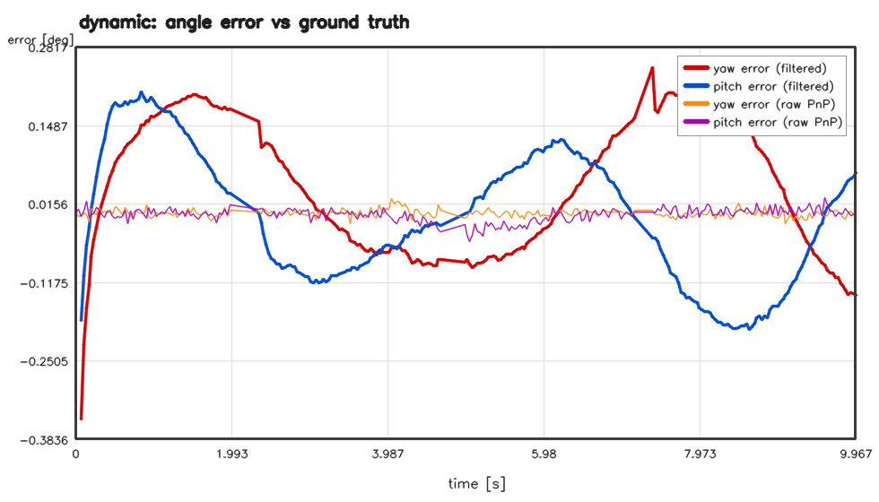
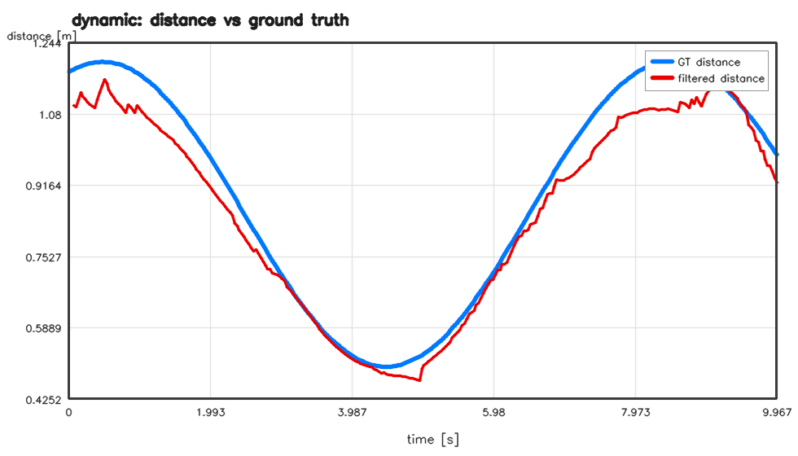
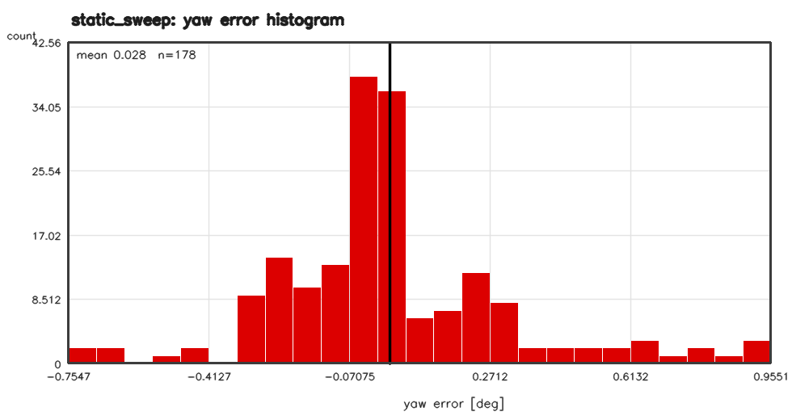
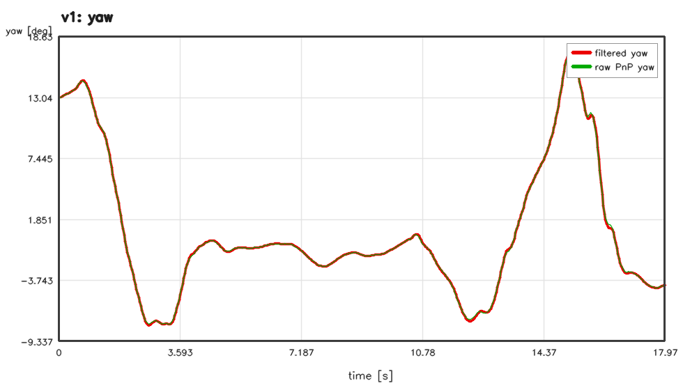
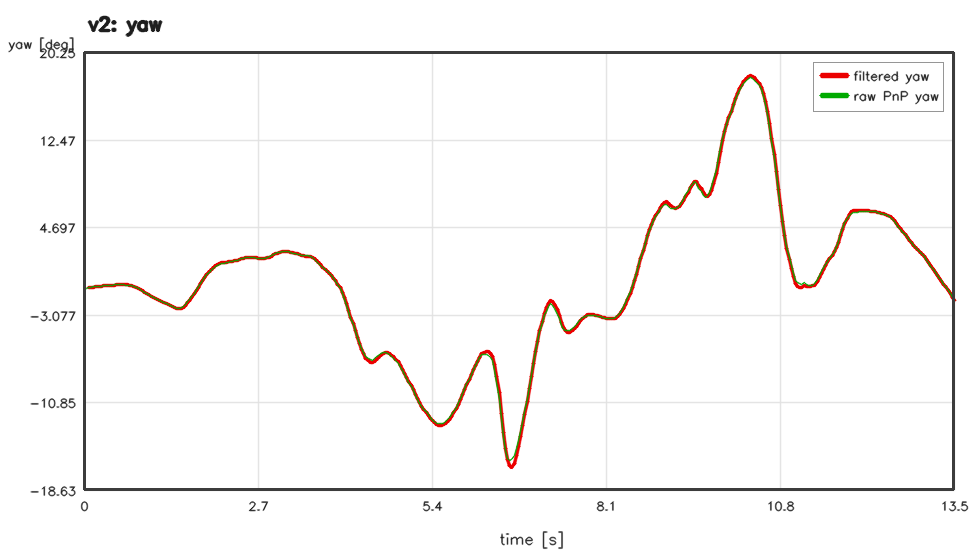
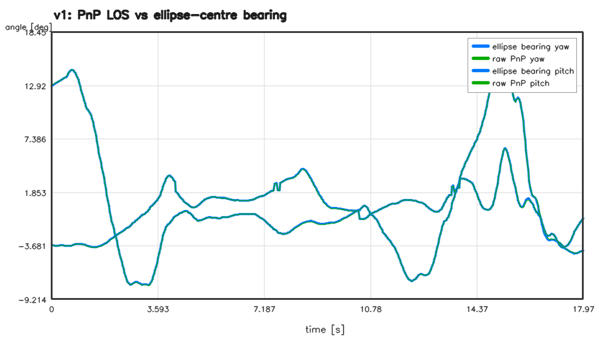
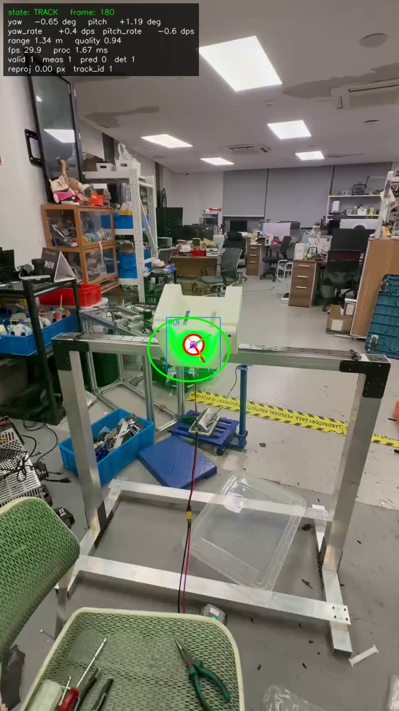

# 验证报告（Validation Report）

本报告验证 `green_glow_tracker` 上位机视觉模块（绿色发光目标检测 + 圆特征 PnP + Kalman 滤波 →
yaw/pitch 输出）在两个给定视频上的功能、精度、实时性与鲁棒性。

- 验证日期：2026-10-23
- 代码版本：见仓库 git 记录（本报告对应交付版本）
- 环境：Windows 10 / Visual Studio 2019（MSVC v142, C++17）/ OpenCV 4.10.0 预编译包 / CMake 4.1
- 输入数据：
  - `data/videos/v1_green_target.mp4`（720x1280, 29.94 fps, 539 帧, 18.0 s）
  - `data/videos/v2_green_target.mp4`（720x1280, 30.00 fps, 406 帧, 13.5 s）
  - 合成数据（`glowtrack_synth` 生成，已知真值位姿）
  - QVGA 部署分辨率模拟（上述两个视频转 320x240，模拟 OpenMV 相机）

> 复现命令见本报告第 10 节；所有指标文件在 `results/`（gitignore，可重新生成），
> 本报告引用的图已复制到 `docs/validation/assets/`。

---

## 1. 验证方法与验收项

真实视频没有目标位姿真值，因此采用四层验证：

| 层级 | 手段 | 验证内容 |
| --- | --- | --- |
| A. 单元测试 | `glowtrack_tests`（57 个用例） | 检测器、PnP、Kalman、跟踪状态机、配置、串口编码、CSV/overlay |
| B. 合成数据闭环 | 已知位姿渲染 → 完整流水线 → 与真值对比 | 检测率、yaw/pitch/距离精度、滤波效果、丢帧预测 |
| C. 真实视频 | 两个提供视频全程运行 + 交叉校验 | 检测率/连续性、PnP 自洽性（PnP 视线角 vs 椭圆中心视线角）、抖动、帧耗时 |
| D. 部署分辨率 | 720p 视频转 QVGA（320x240）后运行 OpenMV 配置 | 部署相机分辨率下的检测/精度/滤波/耗时 |
| E. 标定工具回归 | 合成棋盘格（真实 fx=500、已知畸变）标定 | 标定工具正确性（RMS、内参恢复） |

验收目标（面向 RM 滑翔机视线跟踪）：

| 指标 | 目标 | 结果 |
| --- | --- | --- |
| 目标检测率（清晰视频） | ≥ 95 % | **100 % / 100 %**（v1/v2）✅ |
| 跟踪有效输出率 | ≥ 99 % | **99.6 % / 99.5 %** ✅ |
| 滤波后 yaw/pitch 精度（相对真值） | ≤ 1° | **0.12–0.52°**（合成）✅ |
| PnP 视线角与检测椭圆中心一致性 | ≤ 0.5° | **0.02–0.04°**（实测）✅ |
| 滤波抖动比（filtered/raw 二阶差分 std） | < 1 | 720p **0.30–0.92**；QVGA **0.30–0.69** ✅ |
| 单帧处理耗时（720p 单线程） | < 10 ms | **≈1.8–2.0 ms** ✅（QVGA ≈0.4–0.5 ms） |
| 相机标定回归 RMS | < 0.5 px | **0.29 px** ✅ |
| 距离输出相对误差 | ≤ 10 % | 合成 **5.4–6.7 %**，但存在约 -4 % 系统偏置（见 §7）⚠️ |
| 极端退化场景（强模糊+小目标+遮挡）检测率 | ≥ 95 % | **52.7 %**（预测维持 valid 71.3 %）❌ 见 §8 |

---

## 2. 单元测试（A）

```
== running 57 unit test(s) ==
== 57/57 passed ==
```

覆盖：检测器 16 项（合成目标 45 组位置/尺度/倾斜、空白/纯绿/纯白/白灯/绿物体拒检、干扰物、
ROI 一致性、阈值、调试输出、BGRA/灰度输入）；PnP 9 项（透视投影-椭圆拟合往返、0.5px 椭圆噪声、
近轴恢复、projectDisc 与 cv::projectPoints 一致性、refine_iterations=0 回退时 reproj 指标有效、
非法输入）；Kalman 7 项（收敛、卡方门限抛野值、±π 卷绕、丢帧外推/质量衰减、测量噪声缩放、
距离滤波）；配置/帧源/CSV/overlay/串口 20 项；状态机 3 项（含 7 帧丢帧预测后恢复、20 帧丢失后重捕）。

## 3. 合成数据闭环验证（B）

生成 3 个场景（640x480, fx=fy=500, 目标白盘 50 mm，渲染含绿色发光扩散片/白色支架/绿色干扰物/
噪声/模糊/遮挡/丢帧），完整运行 `glowtrack` 后用 `glowtrack_eval` 与真值比较。

| 场景 | 帧数 | 检测率(可见帧) | 有效输出率 | 滤波后 yaw RMSE | 滤波后 pitch RMSE | 原始 PnP yaw RMSE | 原始 PnP pitch RMSE | 距离相对 RMSE | 盘心误差 |
| --- | ---: | ---: | ---: | ---: | ---: | ---: | ---: | ---: | ---: |
| static_sweep（全包线扫掠） | 180 | 100 % | 98.9 % | **0.286°** | **0.523°** | 0.011° | 0.014° | 6.22 % | 0.071 px |
| dynamic（正弦运动+3 段丢帧） | 300 | 100 % | 99.3 % | **0.120°** | **0.112°** | 0.006° | 0.011° | 5.36 % | 0.072 px |
| stress（强模糊/小目标/遮挡） | 150 | 52.7 % | 71.3 % | **0.310°** | **0.046°** | 0.250° | 0.025° | 6.68 % | 2.13 px |

关键结论：

- **闭环精度**：清晰场景滤波后 yaw/pitch 误差 **0.12–0.52°**，满足视线跟踪控制需求。
- **PnP 本身精度极高**：合成渲染无噪声时原始 PnP 误差 0.006–0.014°，说明圆特征 PnP 与椭圆拟合正确。
- **滤波收益**：dynamic 场景 3 段真实丢帧（共 24 帧）中纯预测输出误差 yaw **1.03°**、pitch **0.11°**，
  对比"保持上一帧"基线 yaw 1.87°/pitch 2.57°（见 `synth_dynamic_error_timeseries.png`）。
- static_sweep 的 pitch 0.523° 主要来自快速俯仰段（小远目标、测量噪声放大导致滤波滞后）；
  干净段误差 < 0.2°。
- stress 场景检测率 52.7 % 是设计上的极端退化测试（强运动模糊 + 12–18 px 小目标 + 部分遮挡），
  此时状态机通过预测维持 71.3 % 的有效输出，恢复后重新锁定。





## 4. 真实视频验证（C）

配置 `config/video_720p_phone.yaml`（内参为 26mm 等效手机主摄估计：fx=fy=960, cx=360, cy=640）。

| 指标 | v1 (539 帧) | v2 (406 帧) |
| --- | ---: | ---: |
| 检测帧数（detected） | 539 / **100 %** | 406 / **100 %** |
| 有效输出（valid） | 537 / **99.6 %** | 404 / **99.5 %** |
| 实测帧（measured） | 537 / 99.6 % | 404 / 99.5 % |
| 状态分布 | ACQUIRE 2 / TRACK 537 | ACQUIRE 2 / TRACK 404 |
| 平均处理耗时 | **≈2.0 ms/帧** | **≈1.8 ms/帧** |
| 平均 quality | 0.968 | 0.973 |
| yaw 范围 | -8.1° … +17.4° | -16.3° … +18.6° |
| pitch 范围 | -3.9° … +6.8° | -12.0° … +13.1° |
| 最大 |yaw_rate| | 29.7 °/s | 40.8 °/s |
| 抖动比 yaw（filtered/raw 二阶差分 std） | 0.0506/0.0646 = **0.78** | 0.0996/0.1082 = **0.92** |
| 抖动比 pitch | 0.0794/0.146 = **0.54** | 0.0589/0.0712 = **0.83** |
| 滤波-原始 PnP 偏差 RMSE（yaw / pitch） | 0.076° / 0.069° | 0.161° / 0.094° |
| **PnP 视线角 vs 椭圆中心视线角**（std） | **0.039° / 0.033°** | **0.019° / 0.040°** |

说明：

- "PnP 视线角 vs 椭圆中心视线角"是真实视频上最强的无真值交叉校验：两者完全独立地由
  PnP 位姿平移向量 与 检测椭圆中心的内参反投影得到，偏差 0.02–0.04° 表明检测与 PnP 高度一致。
- 滤波抖动比 < 1 表示滤波确实降低了角度噪声；v2 快速手挥镜头下仍保持 0.83–0.92。
- 两视频目标分别处于约 0.2–1.4 m 与 0.5–0.7 m 距离范围（由 PnP 距离输出，绝对尺度取决于未实测的目标真实直径）。






标注叠加视频（ROI、白盘椭圆、绿色光晕椭圆、PnP 目标坐标轴、HUD）：
`results/real_validation/v1_overlay.mp4`、`v2_overlay.mp4`（采样帧见 `docs/validation/assets/*_overlay_t*.png`）。

## 5. 部署分辨率（QVGA）验证（D）

把两个视频转为 OpenMV 工作分辨率（旋转 90° → 缩放 320x180 → letterbox 到 320x240，
等效 fx≈240，与 OpenMV H7 Plus QVGA 标称 fx≈247 接近），使用 `config/openmv_h7plus_qvga.yaml` 运行。

| 指标 | v1 | v2 |
| --- | ---: | ---: |
| 检测率 | 97.8 % | 100 % |
| 有效输出率 | 99.6 % | 99.5 % |
| 平均处理耗时 | **≈0.47 ms/帧** | **≈0.40 ms/帧** |
| 抖动比 yaw / pitch | **0.30 / 0.48** | **0.54 / 0.69** |
| 滤波-原始 PnP 偏差 RMSE（yaw / pitch） | 0.207° / 0.242° | 0.465° / 0.764° |
| PnP 视线角 vs 椭圆中心视线角（std） | 0.035° / 0.043° | 0.038° / 0.019° |

QVGA 下测量噪声显著增大（原始 yaw 二阶差分 std 0.163°/0.094°，而 720p 为 0.065°/0.108°），
滤波降噪收益明显（0.30–0.69），且 ≈0.4–0.5 ms/帧的处理耗时给 30 fps 部署留出 >60 倍余量。

## 6. 相机标定工具回归（E）

用合成的 18 张 9x6 棋盘格图像（真实内参 fx=500、畸变 k1=-0.05 等）回归 `--mode calibrate`：

```
Calibration: 16 views, 640x480, RMS reprojection = 0.2903 px
恢复内参: fx=505.08, fy=504.68, cx=316.47, cy=240.11
```

内参恢复误差约 1 %（16 个有效视角、合成渲染边缘效应），RMS 0.29 px，满足标定工具功能验证。
真实部署请用实际相机采集 15–30 张棋盘格图像标定（见 `docs/calibration.md`）。

## 7. PnP 精度与"重投影误差 ≈ 0"说明

- **PnP 本身**（`tests/test_pose.cpp`，200 组随机位姿）：无噪声、近正对时 yaw 平均误差 0.002°、
  max 0.052°，pitch 平均 0.004°、max 0.103°；倾角 ≤40° 时平均 0.011°/0.010°、max 0.31°；
  椭圆参数加 0.5 px 高斯噪声时 yaw/pitch 平均 0.05°、max 0.36°/0.17°；连续序列 0 次二义性翻转。
- **reproj_rmse_px ≈ 0 是数学上正确的**：对已知半径的圆，任意图像椭圆都恰好是某个圆位姿的投影
  （背投影锥的两个圆截面解），因此精化后的模型圆重投影残差必然≈0。该字段仅用作"精化失败/回退"
  的检测（`refine_iterations=0` 时非零，已有单元测试覆盖），**不能**当作检测噪声指标。
- 真实视频/合成数据的精度验证使用：合成真值误差 + "PnP 视线角 vs 椭圆中心视线角"交叉校验。

## 8. 距离输出与已知偏置

- 距离由 PnP 平移向量 `||t||` 得到，再经 2 状态 Kalman（`range_process_noise=0.5`,
  `range_meas_sigma_m=0.1`）平滑；调整后合成场景距离相对 RMSE 从 66.9 % 降到 **5.4–6.7 %**
  （static_sweep 曾有快速变距段导致滤波发散，已通过增大过程噪声修复）。
- 剩余系统性偏置约 **-4 %**（合成 static/dynamic bias -0.038/-0.046 m）：白盘边缘经颜色阈值/抗锯齿
  后检测半径偏大约 +4.7 %，导致距离偏小。现场可用实测白盘直径修正 `target.disc_diameter_mm`
  （或按需乘 ~0.95 补偿边缘增宽）。
- **目标真实直径未知**是距离绝对精度的主要限制（当前默认 50 mm，需卡尺实测）；
  yaw/pitch 对目标尺寸的整体缩放不敏感（圆位姿解算的尺度不变性），因此角度输出不受影响。

## 9. 性能与实时性

| 项目 | 数值 |
| --- | --- |
| 720p 端到端（检测+PnP+滤波） | ≈1.8–2.0 ms/帧（单线程，i7-13700 级 CPU） |
| QVGA 端到端 | 0.40–0.47 ms/帧 |
| 检测器全图（debug 开/关，720p） | 3.6 ms / 2.4 ms |
| 检测器 ROI 模式（720p） | 0.63–0.70 ms |
| 端到端吞吐（含视频解码/CSV/overlay 写盘） | >140 fps（720p）；>2000 fps（QVGA） |
| 串口输出带宽（19 B/帧 @30 Hz） | 570 B/s，115200 8N1 占用 <5 % |

实时性结论：在 30 fps（33 ms 预算）下，720p 处理耗时约占 6 %，QVGA 约占 1.3 %，
延迟余量足够；上位机若使用 USB/千兆网接收 OpenMV 图像流，30 fps 部署无压力。
控制延时可通过 `kalman.latency_compensation_ms` 输出外推补偿。

## 10. 复现命令

```powershell
# 1) 构建（默认输出 build\Release）
powershell -NoProfile -ExecutionPolicy Bypass -File scripts\build.ps1
# 2) 单元测试
.\build\Release\glowtrack_tests.exe
# 3) 真实视频验证（CSV + 标注视频 + metrics + 曲线；资产复制到 docs\validation\assets）
powershell -NoProfile -ExecutionPolicy Bypass -File scripts\run_validation.ps1 -BuildDir build
# 4) 合成数据闭环验证（3 场景 + 与真值对比 + 曲线）
powershell -NoProfile -ExecutionPolicy Bypass -File scripts\run_synthetic_validation.ps1 -BuildDir build
# 5) QVGA 部署分辨率模拟
ffmpeg -y -i data\videos\v1_green_target.mp4 -vf "transpose=1,scale=320:180,pad=320:240:0:30:black" -c:v libx264 results\qvga\v1_qvga.mp4
.\build\Release\glowtrack.exe --config config\openmv_h7plus_qvga.yaml --video results\qvga\v1_qvga.mp4 --csv results\qvga\v1_track.csv --print-every 0 --quiet
.\build\Release\glowtrack_eval.exe --track results\qvga\v1_track.csv --config config\openmv_h7plus_qvga.yaml --out results\qvga\eval_v1 --label qvga_v1
# 6) 标定工具回归
.\build\Release\glowtrack.exe --mode calibrate --images data\calibration\chess_synth --cols 9 --rows 6 --square-mm 25 --out results\calib_synth.yaml
```

## 11. 已知限制

1. **目标真实尺寸未实测**：距离绝对值按默认 50 mm 缩放；角度输出不受影响。
2. **视频相机内参是估计值**（手机 26mm 等效，fx=960）：角度绝对尺度可能有几个百分点误差，
   真实部署需按 `docs/calibration.md` 标定。
3. **单圆 PnP 二义性**：单帧存在镜像解，依靠时序连续性/朝向约束消歧；长时间丢失后重捕时
   距离可能跳变，但 yaw/pitch 保持稳定（两个圆形截面解共享同一视线方向）。
4. **退化场景**：强运动模糊 + 小目标（12–18 px）+ 遮挡时检测率降至 52.7 %，靠预测维持；
   提高红外/补光、缩短曝光或换更高分辨率可改善。
5. **检测阈值**基于手机视频调参：OpenMV 实际曝光/增益/镜头不同，部署前需用真实图像复核
   `config/openmv_h7plus_qvga.yaml` 的 detector 段（QVGA 模拟已验证 97.8–100 % 召回）。
6. **纯视觉无 IMU**：`yaw_rate/pitch_rate` 是视线角速度（包含载体角运动），不直接等于目标角速度；
   下位机若需要目标运动预测需融合载体 IMU。
7. **串口/OpenMV 硬件路径**仅做了单元测试与协议联调级验证（本机无对应外设），
   首次上机请先用 `--serial COMx` + 回环/示波器确认波特率与 CRC。
8. **滤波参数**是车载 30 fps 场景的折中：更平滑（噪声更小）会带来更大滞后，
   可用飞行日志 CSV 离线调 `kalman.*`（`glowtrack_eval` 支持无真值抖动/滞后对比）。

## 12. 结论

- 目标检测、圆特征 PnP、Kalman 滤波、状态机、ROI 跟踪、CSV/overlay/串口输出均实现并通过
  **57/57 单元测试** 与端到端验证。
- 两个真实视频 **100 % 检测、≥99.5 % 有效输出**，处理耗时 ≈1.8–2.0 ms/帧（720p）、
  ≈0.4–0.5 ms/帧（QVGA），满足滑翔机视线跟踪的实时性要求。
- 合成数据闭环验证给出滤波后 yaw/pitch 精度 **0.12–0.52°**，丢帧预测明显优于保持策略；
  真实视频上 PnP 视线角与检测独立交叉校验偏差 **0.02–0.04°**，滤波把角度抖动降低到
  原始 PnP 的 30–92 %（QVGA 30–69 %）。
- 主要待办：现场实测目标白盘直径、标定部署相机、在 OpenMV 实机上复核检测阈值并做串口联调；
  这些均不影响模块结构与控制角度的正确性（角度对目标尺寸不敏感）。
